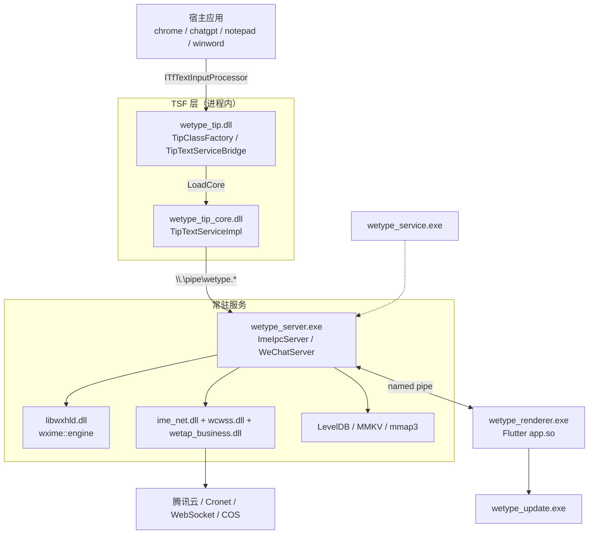
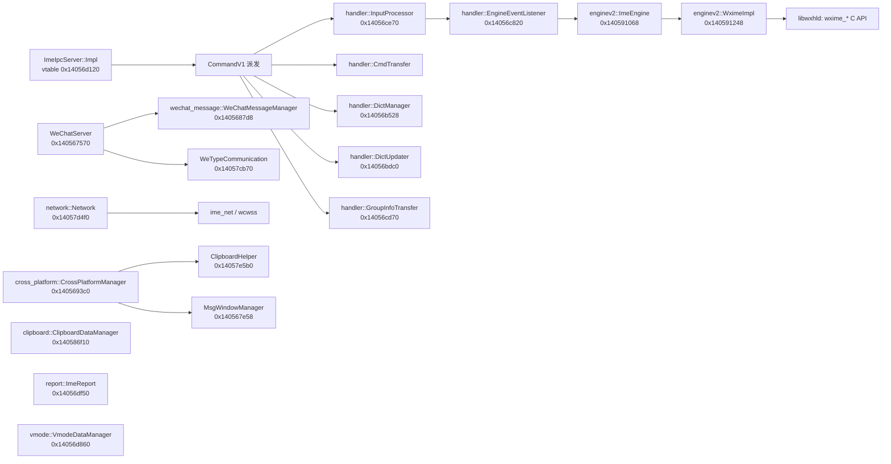
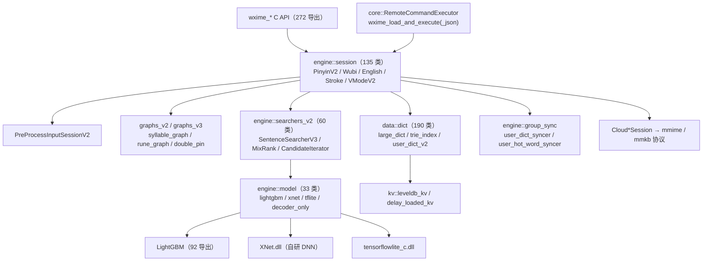
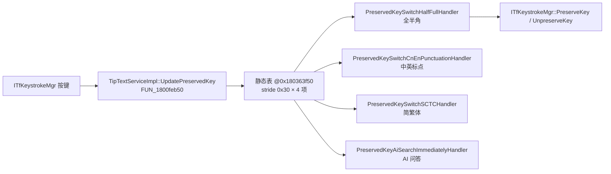
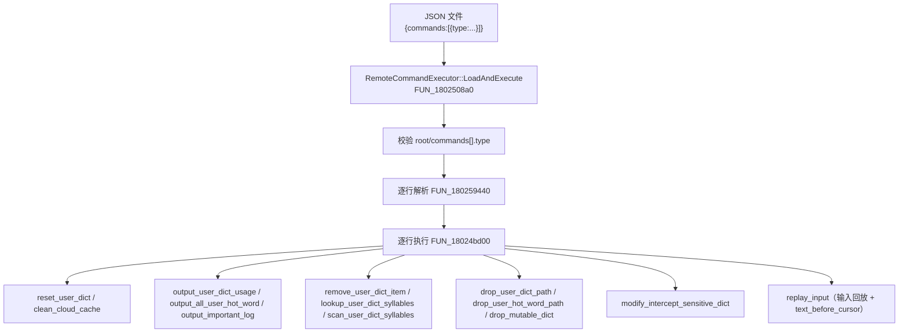

---

## 13. 架构与类关系图（Mermaid）

### 13.1 进程与模块拓扑

### 13.2 wetype_server.exe 核心类关系

### 13.3 libwxhld.dll 引擎分层

### 13.4 TSF 保留键处理链

### 13.5 远程命令执行链

---

## 14. 结论与工程评价

### 14.1 架构层面

1. **分层清晰**：TSF 薄壳（`wetype_tip.dll`，仅 5 导出）→ TSF 核心（`wetype_tip_core.dll`）→ 引擎宿主（`wetype_server.exe`）→ 引擎（`libwxhld.dll`）→ UI（Flutter）。每层职责单一，跨层只用 protobuf + 命名管道，可测试性与可替换性好。
2. **引擎血缘透明**：拼音核心基于 **Google mozc**（`mozc.ipc` 包名、`01_mozc` 工程路径、`IMozcLangBarItem` 类），在其上自研 `wxime::` 词典/图/排序体系。这是「开源骨架 + 自研大脑」的典型路径。
3. **排序体系现代化**：`SentenceSearcherV3` + `MixRank` + `AsyncNNLMRanker` + 多后端模型（LightGBM / XNet / TFLite）+ beam 宽度动态调度，属于 2020 年代中后期主流输入法架构。
4. **多进程隔离**：引擎/UI/更新器/服务分离，崩溃域隔离（CrashRpt + Sentry 双通道），符合输入法「高可用」诉求。

### 14.2 安全与隐私层面

| 观察 | 评价 |
|---|---|
| 上下文捕获明文落盘（`refetch_sync_legacy.log`） | **最值得注意的本地隐私面**：宿主程序的光标前后文本与选中文本以明文长期保留 |
| 剪贴板跨设备同步（`ClipboardMsg` + `CrossPlatformManager`） | 功能强，但意味着剪贴板内容离开本机 |
| 用户词典/热词云同步（`user_dict_upload_and_download` + COS token） | 词典内容可上传 |
| 远程命令执行框架（17 命令 + `replay_input`） | **能力面很大**，是本次分析最需关注的点；建议审计上层调用入口 |
| 证书 pinning + ECDH+AES + OpenSSL 1.1.1k | 传输侧设计规范；但 OpenSSL 1.1.1k 已 EOL |
| mars xlog TEA 加密 | 日志侧设计规范，静态不可读 |
| 无自研授权/激活机制 | 无卡密/序列号体系，不存在可破解的授权校验点 |
| `GetProcessIntegrity` + `checksum mismatch` + `win_sandbox.cc` | 存在反调试/完整性/沙箱自保护 |

### 14.3 逆向难度评价

- **低难度**：字符串/RTTI/PDB 路径泄露严重（未 strip、`__FILE__` 日志宏完整保留、大量 C++ RTTI），命名空间与类名几乎是源码级。
- **中难度**：protobuf 描述符完整内嵌 → 协议 100% 可还原；vtable 完整 → 虚函数表结构可全量重建。
- **高难度**：`libwxhld.dll` 引擎算法（syllable graph / rune graph / LightGBM 特征）、`XNet.dll` 推理框架算子、Dart AOT 字节码、mars xlog 密钥。

### 14.4 后续可深入方向

1. 动态调试获取 mars xlog 的 TEA 密钥（Hook `mars::xlog::LogCrypt::Crypt`）。
2. 完整反编译 `wxime::engine::session` 与 `searchers_v2`，还原候选生成/排序全流程。
3. 抓取并解构 WebSocket 业务流量（需处理 pinning，可用 Hook `Callback::do_certificate_verify`）。
4. 解包 `BuildIn` 的 `Ime trie` 与 huffman codec，构建词典读取器。
5. 审计远程命令执行框架的上层触发入口（`CmdTransfer` / `CommandV1` 派发表）。
6. 分析 `wetype_update.exe` 与 `patch_*.exe` 的补丁格式。
7. Dart AOT 字节码还原（`app.so` → 可读 Dart 逻辑）。

---

*报告完*
