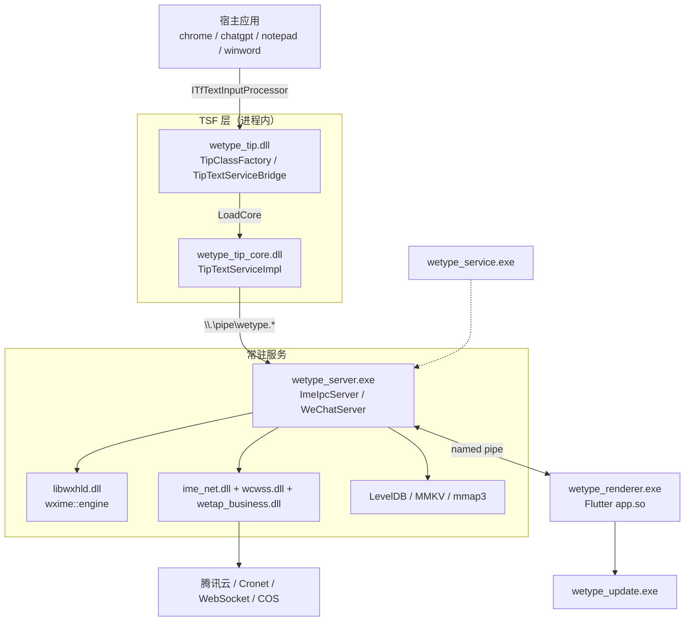
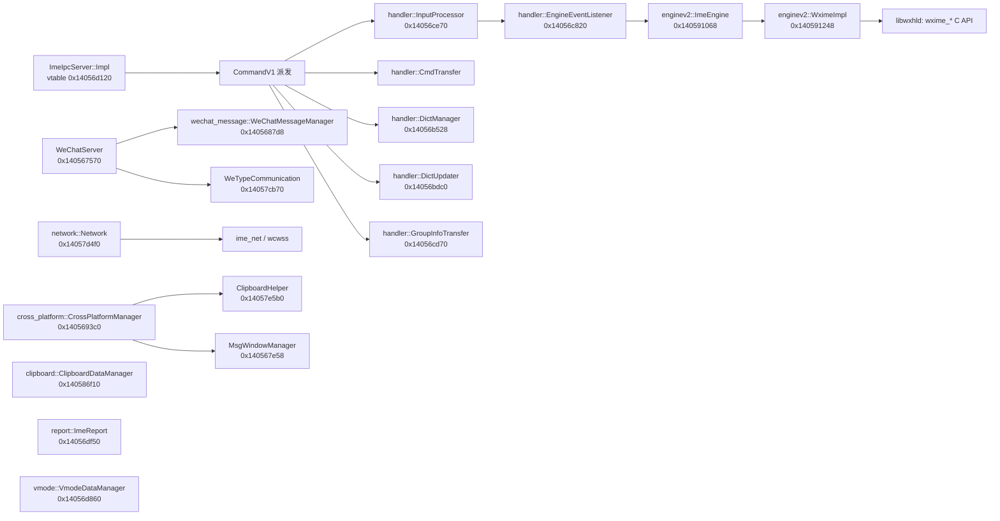
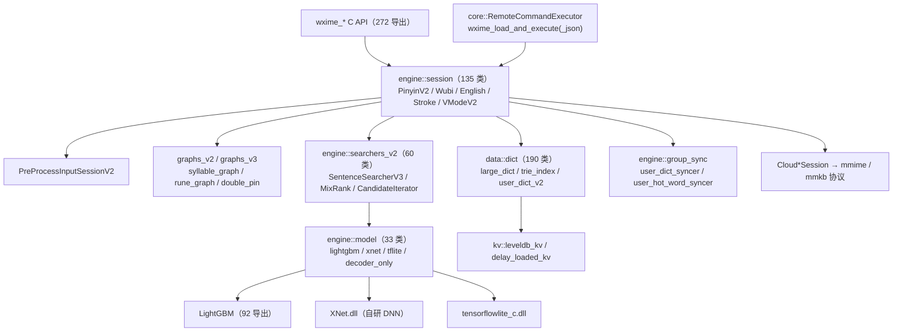
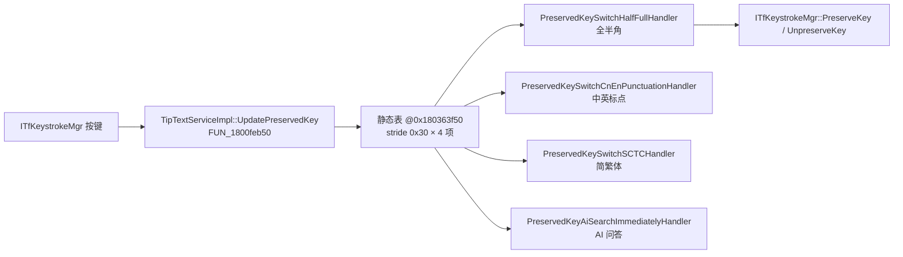
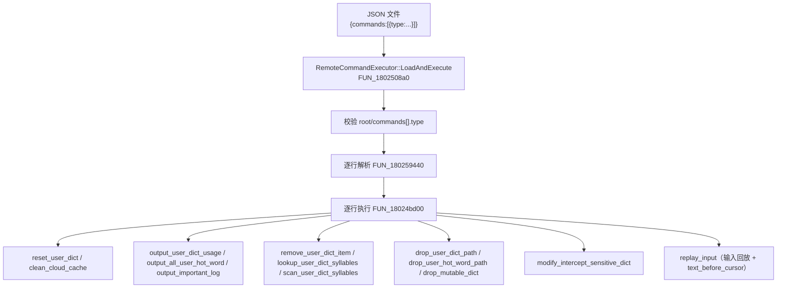

# 微信输入法 (WeType) Windows 版逆向分析报告

- 版本：**2.1.4.6**（注册表 DisplayName = 微信输入法，InstallLocation = `C:\Program Files\Tencent\WeType`）
- 平台：Windows x64（另有 x86 版 TIP 核心）
- 分析性质：**静态逆向 + 本机运行时产物取证**（样本为已安装的官方签名二进制）
- 工作区：`D:\VibeCoding\微信输入法逆向`

> 本报告全部结论来自对二进制、内嵌字符串/RTTI/PDB 路径、Ghidra 反编译、protobuf 描述符还原、Dart AOT 快照解析与本机运行时数据目录的静态分析，未对样本做任何修改。

---

## 0. 结论速览

| 维度 | 结论 |
|---|---|
| 架构 | 典型「多进程 + TSF TIP + Flutter UI」输入法：TSF 桥接 DLL → 常驻服务 → Flutter 渲染器 → 独立更新器，全部通过**命名管道 + 共享内存**通信 |
| 输入法框架 | **纯 TSF TIP**（无传统 IME 键盘布局注册），TIP 薄壳 + 核心 DLL 双层 |
| 引擎血缘 | 拼音核心源自 **Google mozc**（内嵌 `mozc.ipc` 包名、`01_mozc` 工程路径）；词典/排序自研（`wxime::`），排序器含 **LightGBM** + 多后端神经网络 |
| 网络 | 自研 `wetap::net`（基于 **Cronet**）+ `wcwss`（WebSocket++/Asio）+ **微信 mars xlog**；AES + ECDH 握手；证书公钥固定（pinning） |
| 推理 | `XNet.dll`（自研 DNN 框架，3180 个导出）+ `tensorflowlite_c.dll`（TFLite，`nlrgpt2_nnlm.bin` 为 TFL3 flatbuffer 模型） |
| UI | Flutter（`flutter_windows.dll` + Dart AOT `app.so`，工程名 `my_desktop_app`，387 个 Dart 模块） |
| 重大发现 1 | **远程命令执行框架**：`wxime_load_and_execute` / `wxime_load_and_execute_json` 导出，支持 17 种远端下发命令，含 **`replay_input`（输入回放）** |
| 重大发现 2 | **上下文捕获**：TIP 通过 TSF 读取宿主程序光标前后文本/选中文本，并落盘明文日志 `refetch_sync_legacy.log`（本机 2571 条记录，1291 条捕获成功，含真实用户文本） |
| 重大发现 3 | 输入法自带 **完整 libcurl + OpenSSL 1.1.1k**、**证书 pinning**、**Sentry 崩溃上报**、**CrashRpt**、**flurry** 埋点 |
| 授权机制 | **无自研激活/序列号/卡密机制**（keygen 类字符串全部为 OpenSSL 配置项） |

---

## 1. 样本与安装布局

### 1.1 目录结构

```
C:\Program Files\Tencent\WeType\
├─ 2.1.4.6\                    # 主程序 + 资源（658 文件 / 406.6 MB）
│  ├─ wetype_server.exe        # 输入法引擎宿主服务（常驻）
│  ├─ wetype_renderer.exe      # Flutter UI 渲染器
│  ├─ wetype_update.exe        # 更新器（20.44 MB）
│  ├─ wetype_service.exe       # WeType Management Service
│  ├─ wetype_installer.exe
│  ├─ libwxhld.dll             # 拼音/引擎核心（19.68 MB）
│  ├─ ime_net.dll              # 网络层（Cronet 封装，3.01 MB）
│  ├─ wcwss.dll                # WebSocket 客户端（3.41 MB）
│  ├─ wetap_business.dll       # 业务层（3.55 MB）
│  ├─ XNet.dll                 # 自研 DNN 推理框架（17.78 MB）
│  ├─ tensorflowlite_c.dll     # TFLite（7.85 MB）
│  ├─ flutter_windows.dll      # Flutter 引擎（17.99 MB）
│  ├─ input_dll_import_lib.dll # mozc 派生输入法核心（0.44 MB）
│  ├─ WXP2PTransfer.dll        # 点对点文件传输（1.43 MB）
│  ├─ WeUIResource.dll, flurry.dll, icudtl1.dat, ...
│  ├─ BuildIn\                 # 内置词典 37 项（含 51.7 MB 二级词库）
│  ├─ flutter_datas\business_data\flutter_assets\
│  └─ voice_engine\vad\        # VAD 语音模型
└─ WetypeCore_2.1.4.6\{x64,x86}\
   └─ wetype_tip_core.dll + CrashRpt1500.dll   # 真正的 TSF 核心（按位数分发）
```

### 1.2 关键样本与哈希

| 文件 | 大小 | 说明 |
|---|---|---|
| wetype_server.exe | 7.85 MB | MD5 `aad0484c206fcdc376e01f69a36dc35d` / SHA256 `5e9687be857ac931bf2e0ddecfee75b72a71405701be2a340659db0464edf4d5` |
| wetype_service.exe | 2.22 MB | MD5 `f5c236a6b6519b9a412be45f7bf6c380` / SHA256 `98b07086cf76b5051910bfd1b6413c91400ccf7f3ccce0d5e52b4bd774cc92a0` |
| C:\Windows\System32\wetype_tip.dll | 2 484 272 B | SHA256 `b2410b40ab8ecc83907f40b54c224f50e76549ec61c9c176fd3d1fe65f356540`（薄壳） |
| WetypeCore_2.1.4.6\x64\wetype_tip_core.dll | 5 294 120 B | SHA256 `ba8a4b582f9ca1cf4b783d9d1e2f79f7bae196a27f7d653ef3d5c15001ccfa77`（核心） |

- 全部样本 **Authenticode 签名有效**，签名者 `CN=Tencent Technology (Shenzhen) Company Limited`。
- 泄露的开发机路径（PDB / `__FILE__` 日志宏）：
  - server 家族：`E:\workspace\WeChatPinYin\wxkb\01_mozc\...`
  - 引擎家族：`E:\data\landun\workspace\wxime\...`
  - TIP：`...\cmake-build-x64-release\win32\shell\wetype_tip_x64.pdb`
  - Flutter 引擎：`E:\workspace\repo\FlutterEngine\engine\src\out\host_release\flutter_windows.dll.pdb`

### 1.3 运行时数据目录

| 路径 | 内容 |
|---|---|
| `C:\ProgramData\Tencent\WeType` | `server_config.ini`（slash_switch/is_new_install）、`patch\config.yaml`、`patch\patch_3.0.0.34.exe`(186 MB)、`patch_exec\patch_2.1.4.6.exe`(180 MB) |
| `%APPDATA%\Tencent\WeType\MMKV` | `WetypeMultiProcessInfo`、`WetypeUpdateInfo`（MMKV 1.2.5 格式 + .crc） |
| `%LocalLow%\Tencent\WeType` | **核心运行时目录**：mars xlog、mmap3、IPC 路径文件、词典库、崩溃日志 |
| `%LocalLow%\Tencent\WeType\DictDir2` | **LevelDB**：`v5\<uid>\*.ldb`（用户词典）、`user_hot_word\*.ldb`（热词） |
| `%LocalLow%\Tencent\WeType\Dict` | 增量下发的 cell 词典（含 `CommonDictIndexV2.json` / `HotDictIndexV2.json`） |
| `%LocalLow%\Tencent\WeType\context_capture\refetch_sync_legacy.log` | **上下文捕获明文日志**（926 KB） |

IPC 路径文件（记录命名管道名/版本）：`renderer_for_tip.ipc`、`server_for_renderer.ipc`、`update_for_renderer.ipc`、`session_v2.ipc`、`session_v2_update.ipc`、`update_session_v2.ipc`（各 51–53 字节），对应 protobuf `wetype.ipc.IPCPathInfo`。

日志：`MM_SERVER_20261017.xlog`(456 KB)、`MM_WETYPE_20261017.xlog`(689 KB)、`MM_RENDER_20261017.xlog`(4.9 KB) + 对应 `.mmap3`(153600 B)。均为 **mars xlog v2**（首字节 0x0A=sync zstd start / 0x0C=async zstd start），载荷为 TEA 加密 + zstd，密钥由进程内 `LogCrypt` 持有，静态无法还原（见 §8.5）。

---

## 2. 进程与模块架构

```
┌──────────────────────────── 宿主应用（chrome.exe / chatgpt.exe / notepad.exe / winword.exe ...）
│   TSF (Text Services Framework)
│        │  ITfTextInputProcessor / ITfKeystrokeMgr / ITfThreadMgr
▼        ▼
wetype_tip.dll (System32, 薄壳, CLSID {86598FB9-66A2-463E-B9C2-AEB906D477AD})
  TipClassFactory → TipTextServiceBridge → LoadCore()
        │  动态加载 WetypeCore\<arch>\wetype_tip_core.dll
        ▼
wetype_tip_core.dll  ── wetype::win32::tsf::TipTextServiceImpl (真正的 TIP 实现)
        │                       ├─ TipEditSession / CompositionSinkImpl
        │                       ├─ TipCandidateListImpl / TipLangBar*
        │                       └─ PreservedKeyActionHandler × 5
        │
        │  命名管道 \\.\pipe\wetype.*  +  CreateFileMapping 共享内存
        ▼
wetype_server.exe  ── wetype::server::*  (引擎宿主 + IPC 路由 + 网络 + 跨端同步)
        │      ├─ ImeIpcServer (IpcServerV2)
        │      ├─ enginev2::ImeEngine / WximeImpl ──► libwxhld.dll (wxime_* C API)
        │      ├─ network::Network ──► ime_net.dll / wcwss.dll ──► Cronet / WebSocket
        │      ├─ clipboard::ClipboardDataManager
        │      ├─ cross_platform::CrossPlatformManager + MsgWindowManager
        │      ├─ wechat_message::WeChatMessageManager（表情/WeChat 联动）
        │      ├─ vmode::VmodeDataManager（V 模式）
        │      ├─ report::ImeReport（埋点上报）
        │      └─ data::{Config, KvHolder, LevelDBKV, PrefixDB}
        │
        │  命名管道
        ▼
wetype_renderer.exe (Flutter/Dart AOT app.so)  ── 候选框 / 设置面板 / 表情面板 / 剪贴板 UI
        │      MethodChannel: floatingChannel / kvChannel / logChannel /
        │                     settingsChannel / stateChannel / upgradeChannel /
        │                     utilChannel / voiceChannel
        ▼
wetype_update.exe  ── 增量更新（patch_*.exe 下发与执行）
wetype_service.exe ── Windows 服务（管理/生命周期）
```

### 2.1 IPC 通道（已确认）

- 命名管道前缀：`\\\\.\pipe\wetype.`（server 与 tip_core 各有该常量）
- 类：`wetype::base::UniqueNamedPipe` → `Connect` / `Receive` / `Send`，配合 `GetNamedPipeClientProcessId` 做对端进程校验
- 共享内存：`CreateFileMapping()` / `MapViewOfFile()` / `MapViewOfFileEx`（server + tip_core 均实现）
- 消息封装：`wetype::commands::CommandBase` / `CommandV1`（vtable 区分类型），序列化 = protobuf

### 2.2 消息总线协议（`commands.proto`）

`package wetype.commands`，43694 字节 / 1271 行，核心消息：

- `Input`：`CommandType, key, application_info, commit, candidate_count, fuzzy_pinyin, ...`
- `KeyEvent`：`SpecialKey` 枚举 77 项 + `ModifierKey` 位标志
- `CandidateWord / CandidateList / CandidateWordSyllable`
- `PendingWord`（`PendingInputType` 8 项）/ `PendingList`
- `FuzzyPYInfo`（20 个模糊音开关）、`KeyboardTypeInfo`、`DictItem`
- `ApplicationInfo`：`process_id, thread_id, receiver_handle, target_window_handle, current_position, target_rect, handle_valid`
- `AiSearchResult`、`TranslateResult`、`UpdateWindowStatus`、`RendererWindowStatus`

`renderer_command.proto`（TIP → Renderer 的窗口/候选框控制总线）：

- `RendererCommand`：`type, key, output, application_info, visible, menu_bar_pos, need_update, log_data, input_status, index, font_size, status_pos, uiless_visible, select_candidate_index, is_show_more_candidate, report, engine_candidate_mode, quit_event_type, config_hide_status_bar, move_pending_valid, update_quit_event_type`
- `enum CommandType`：NOOP / UPDATE / SENDKEY / SHUTDOWN / CHANGEPOS / SELECT_CUR_CANDIDATE / SELECT_NEXT_LINE / SELECT_PREV_LINE / SHOW_FAST_MENU / SET_UPDATE_STATUS / Log / HIDE_FAST_MENU / DTOR_INPUT_STATUS / SELECT_FOCUSED_CANDIDATE / MOVE_CURSOR / DISCARD_PENDING / SUBMIT_PENDING
- `enum RenerderCommandType`（原文拼写）：SELECT_CANDIDATE / SHOW_MORE_CANDIDATE / SEND_KEY / CHANGE_SHOW_MORE_STATUS / NOTIFY_UPDATE_STATUS / STOP_SPAWN_PROCESS / SHOW_CONFIG_MENU_WND / RTOD_INPUT_STATUS / NOTIFY_SWITCH_STATUS / NOTIFY_SHORTCUT_KEY / SHOW_SETTINGS_WINDOWS / SET_STATUS_POS

---

## 3. 模块详解

### 3.1 wetype_tip.dll —— TSF 薄壳（System32）

- 导出仅 5 个：`DllCanUnloadNow`、`DllGetClassObject`、`DllRegisterServer`、`DllUnregisterServer`、`__ASSERT`（标准 COM 进程内服务器）。
- 类：`wetype::win32::tsf::{TipClassFactory, TipTextServiceBridge, TipTextServiceBridgeImpl}`
- 职责：**只做桥接**，自身实现 `ITfTextInputProcessor`，在 `OnActivate` 时调用 `LoadCore` 动态加载对应位数的 `wetype_tip_core.dll`，然后把 TSF 的回调（KeyEventSink / ThreadFocusSink / ThreadManagerEventSink / CompartmentEventSink）转发给核心。
- 关键字符串：`wetype_tip_x64.dll`、`wetype_server.exe`、`wetype_renderer.exe`、`wetype_update.exe`、`wetype_tool.exe`、`WeType`、`AdviseCompartmentEventSink GUID_COMPARTMENT_KEYBOARD_INPUTMODE_CONVERSION failed: {}`、`GUID_COMPARTMENT_KEYBOARD_OPENCLOSE failed: {}`、`SetLanguageProfileDisplayName failed.`
- PDB：`...\cmake-build-x64-release\win32\shell\wetype_tip_x64.pdb`

### 3.2 TSF 注册信息（注册表）

| 项 | 值 |
|---|---|
| `HKLM\SOFTWARE\Microsoft\CTF\TIP\{86598FB9-66A2-463E-B9C2-AEB906D477AD}` | `Enable=1` |
| `...\InprocServer32` | `C:\Windows\system32\wetype_tip.dll`，`ThreadingModel=Apartment` |
| `...\LanguageProfile\0x00000804\{607FDF85-FCC8-4DBD-A365-41296F980C9C}` | `Description=WeType`，`IconFile=C:\Windows\system32\wetype_tip.dll`，`IconIndex=0`，`Display Description=@C:\Windows\system32\wetype_tip.dll,-102`，`Enable=1` |

- **键盘布局注册表中无 wetype/微信 条目** → 该输入法**不使用传统 IME（`ImmInstallIME` / 键盘布局）**，纯 TSF TIP。
- 语言配置 GUID 使用 `0x00000804`（简体中文 zh-CN）。

### 3.3 wetype_tip_core.dll —— TSF 核心

- 类（`wetype::win32::tsf` 命名空间，21 个类）：`ITipTextService, TipTextService, TipTextServiceImpl, TipTextServiceFactory, TipEditSession, TipEditSessionImpl, TipEditSessionWrapper, TipClient, TipCandidateListImpl, TipIndicatorImpl, TipReadingInfoImpl, TipDisplayAttribute(Input/Converted), TipEnumDisplayAttributes, TipLangBarButton, TipLangBarToggleButton, TipLangBarCallback, TipUiElementDelegate(Impl), TipImmersiveUiElementImpl, CompositionSinkImpl, ReadOnlyEditSession, SurroudingTextUpdater, GetPreferredTouchKeyboardLayoutImpl, tip_theme_manager, IMozcLangBarItem/ToggleItem`
- 接口：`ITfTextInputProcessor` / `ITfTextInputProcessorEx`（RTTI `.?AUITfTextInputProcessor@@` @18042c768）。
- AI 协议：`wetype::pb::askai` 命名空间 10 个类（BaseReq/BaseRsp/Header/HeaderItem/CmdReq/CmdResp/CmdMultiTurnReq/CmdMultiTurnResp/CmdStartPageReq/CmdStartPageResp）。
- 另有 `wetype::commands`(72)、`wetype::server`(41)、`wetype::multiplatform`(39)、`wetype::update`(38)、`com::tencent::wetype::pb`(17)。

#### 保留键（PreservedKey）机制

`TipTextServiceImpl::UpdatePreservedKey`（FUN_1800feb50 @1800feb50，2083 字节，源码 `win32\tip\tip_text_service.cc`）：

1. 取 `*(param_1+0x278)`（thread_mgr_），为空则记 `thread_mgr_ is nullptr.`（:0x488）
2. 检查 `(*(uint*)(param_1+0x340) >> 2 & 1)`
3. `QueryInterface` → `ITfKeystrokeMgr`（GUID @DAT_180369b60），失败记 `Query ITfKeystrokeMgr failed: {}.`（:0x492）
4. 遍历静态表 `&DAT_180363f58`（stride 0x30），逐项调用 `ITfKeystrokeMgr::UnpreserveKey`（vtable+0x68）/ `PreserveKey`（vtable+0x60）
5. 日志：`PreservedKey registered: vk={:#x} mod={:#x} action={}` / `PreservedKey unregistered: vk={:#x} mod={:#x} action={}`（模块名 `WeTypeDll`）

**保留键静态表**（表头 0x180363f50，stride 0x30，4 项）：

| # | action | 掩码 | 功能名（UTF-16） |
|---|---|---|---|
| 1 | 7 | 0x4 | 全半角输入切换 |
| 2 | 9 | 0x8 | 中文下中英标点切换 |
| 3 | 7 | 0x8000 | 简繁体输入切换 |
| 4 | 8 | 0x10000 | 快速唤醒AI问答 |

（vk/mod 字段在静态表中存放的是指向配置对象的指针，实际键位在运行时由用户配置决定；第 4 项指针内容为 `78 56 34 12 34 12 34 12 ...` 占位常量，进一步印证。）

处理器类（RTTI）：`PreservedKeyActionHandler`(18042bda0)、`PreservedKeySwitchHalfFullHandler`(18042bdf0)、`PreservedKeySwitchCnEnPunctuationHandler`(18042be40)、`PreservedKeyAiSearchImmediatelyHandler`(18042be90)、`PreservedKeySwitchSCTCHandler`(18042bee0)。

---

### 3.4 wetype_server.exe —— 引擎宿主与中枢

命名空间类统计（193 命名空间 / 852 类）：`CryptoPP`(83)、`wetype::commands`(67)、`wetype::multiplatform`(39)、`wetype::update`(38)、`wetype::server`(37)、`com::tencent::wrbus::pb`(29)、`wetype::server::data`(16)、`wetype::server::handler`(12)。

关键类（含 vtable 地址与槽位数）：

| 类 | vtable | n |
|---|---|---|
| `enginev2::ImeEngine` | 0x140591068 | 96 |
| `enginev2::WximeImpl` | 0x140591248 | 60 |
| `handler::DictManager` | 0x14056b528 | 20 |
| `handler::DictUpdater` | 0x14056bdc0 | 20 |
| `handler::EngineEventListener` | 0x14056c820 | 11 |
| `handler::GroupInfoTransfer` | 0x14056cd70 | 29 |
| `handler::InputProcessor` | 0x14056ce70 | 15 |
| `data::Config` | 0x14056ee80 | 6 |
| `data::IKV / KvHolder / PrefixDB` | 0x140585ce0 / 0x140585d20 / 0x140585d30 | 42 / 34 / 32 |
| `data::LevelDBKV / LevelDBIterator / PrefixIterator` | 0x14058e940 / 0x14058e988 / 0x14058e9c8 | 8 / 16 / 8 |
| `network::Network` | 0x14057d4f0 | 9 |
| `clipboard::ClipboardDataManager` | 0x140586f10 | 17 |
| `cross_platform::CrossPlatformManager` | 0x1405693c0 | 27 |
| `cross_platform::MsgWindowManager` | 0x140567e58 | 8 |
| `cross_platform::ClipboardHelper` | 0x14057e5b0 | 8 |
| `wechat_message::WeChatMessageManager` | 0x1405687d8 | 17 |
| `report::ImeReport` | 0x14056df50 | 27 |
| `vmode::VmodeDataManager` | 0x14056d860 | 14 |
| `WeChatServer / ImeIpcServer / WeTypeCommunication` | 0x140567570 / 0x14056d120 / 0x14057cb70 | 2 / 13 / 33 |

源码文件（来自 `__FILE__` 日志宏，94 条路径）：`server/wetype_server_main.cc`、`server/wechat_server_v2.cc`、`server/enginev2/{wxime_engine_impl, wxime_session_info}.cpp`、`server/handler/{cmd_transfer, dict_manager, dict_updater, engine_event_listener, input_handler}.cpp`、`server/data/{config, session_config_rw}.cpp`、`server/ipc/{ipc_server.cpp, ipc_path_manager.cc, named_event.cc}`、`server/http_client/{CurlHttpClient, HttpClient}.cpp`、`server/network/network_manager.cpp`、`server/report/ime_report.cpp`、`server/performance_monitor/performance_monitor.cpp`、`server/modules/clipboard/clipboard_data_manager.cpp`、`server/modules/crossPlatformSync/{clipboard_helper, cross_platform_manager, msg_window}.cpp`、`server/modules/file_transfer/file_transfer_push_relay.cpp`、`server/modules/vmode/vmode_data_manager.cpp`、`server/modules/wechatMessageMgr/wechat_message_manager.cpp`、`base/{CrashRptMgr.cc, FileUtils.cpp, MMKVUtils.cpp, ZipUtils.cpp, file_util.cc, ipcServer/ipc.cpp, logging.cc, mmSingleton.cpp, mmap.cc, performance_util.cpp, process_mutex.cc, system_util.cc, win_sandbox.cc, win_util.cc}`

第三方：**微信 mars**（网络库）、`mmkv_1.2.5`、`abseil`、`curl`、`protobuf`、`wil`、`crypto++`（源码路径 `C:\Users\dreamsunliu\source\repos\Project5\Project5\crypto++`）、`openssl-1.1.1k`（`D:\downloads\openssl-1.1.1k`）。

#### IPC 服务端（IpcServerV2）

`ImeIpcServer::Impl::Process`（FUN_1401069b0）：

```c
FUN_14013e9a0(local_108, 0);
local_108[0] = wetype::commands::CommandBase::vftable;
if (!FUN_14037d470(local_108, *param_2, *(uint*)(param_2+1))) {   // 反序列化
    FUN_14007d630(2, "...\\server\\ipc\\ipc_server.cpp", 0x5a,
                  "wetype::server::ImeIpcServer::Impl::Process", "IpcServerV2", "Invalid request");
}
FUN_140106660(local_78, local_108);            // 解析成 CommandV1
// 单例惰性初始化
lVar1 = *(longlong*)(param_1 + 0xe0);
lVar3 = *(longlong*)(lVar1 + 8);
if (lVar3 == 0) { lVar3 = FUN_14014be30(); *(longlong*)(lVar1 + 8) = lVar3; }
local_e0 = wetype::commands::CommandV1::vftable;
FUN_14014be40(lVar3, &local_e0);               // 派发
```

- `onClientConnect` = FUN_140107b80（:0x89）、`onClientDisConnect` = FUN_140107cf0（:0x9e）
- 析构 = FUN_1401065b0：释放 `lsignal::slot::vftable`（+0xb0），对象大小 **0xf0**
- 事件槽实现使用 **lsignal** 库（`.?AVslot@lsignal@@`）

#### 引擎桥（WximeImpl → libwxhld）

| 槽 | 函数 | 行为 |
|---|---|---|
| s2 | FUN_14019fd90 | 把 (name,value) 数组（元素 0x18 字节：ptr/len/u32）转成配置项后调 `wxime_config_dict` |
| s3 | FUN_14019f9c0 | `wxime_add_cell_dict(ptr, len, 0)`（带 SSO 判定，容量 0xf） |
| s4 | wxime_clear_cell_dicts | 跳转表未恢复（Ghidra: Too many branches） |
| s5 | FUN_1401a1010 | `FUN_1401a0640(*(param_1+0x5d0))` |

#### 微信消息联动（WeChatMessageManager）

`HandleWeChatMessage` = FUN_1400c8180（5961 字节），源码 `server\modules\wechatMessageMgr\wechat_message_manager.cpp`（行号 0x54/0x5a/0x5f/0xb8/0xea）：

- `switch(local_2c0)` 按 `WeTypeCommandType` 分发；case 4 = WTSupportEmojiResponse，case 2 = 默认未处理，0xe/2/0x10 走 LAB_1400c85f7
- 字符串常量：`[wechat_comm] wechat emoji is disabled`(0x140568a40)、`token is valid`(0x140568c08)、`token is expired`(0x140568c28)
- RTTI：`.?AVWTEmitEmojiRequest@server@wetype@@`(0x140709538)、`.?AVWTEmitEmojiResponse@server@wetype@@`(0x140709570)

---

### 3.5 libwxhld.dll —— 拼音引擎核心

- 706 命名空间 / 2578 类。PDB：`E:\data\landun\workspace\wxime\build\wxime\c_api\RelWithDebInfo\libwxhld.pdb`
- 导入 `XNet.dll` / `tensorflowlite_c.dll` / `ime_net.dll`；导出 272 个（92 个 LightGBM + ~60 个 `wxime_*` C API）
- 核心命名空间：`wxime::data::dict`(190)、`wxime::engine::session`(135)、`LightGBM`(120)、`mmime`(76)、`wxime::engine::searchers_v2`(60)、`wxime::data`(46)、`mmkb`(43)、`wxime::base`(41)、`wxime::engine::model`(33)、`wxime::logging`(30)

#### 会话（Session）体系（135 个组件）

`AsyncSessionV2`、`PinyinV2Session`、`PinyinV2WarmUpSession`、`WubiSessionV2`、`EnglishSessionV2`、`NumberSession`、`StrokeSession`、`StatusSession`、`UserHotWordsSession`、`UserScenesSession`、`PunctRelatedSession`、`PreProcessInputSessionV2`、`VModeV2`、`DirtyCheckingSession`、`SearchCandidatesInstantly(ForHW/WithPreProcess)`、`AutoMostLikely(ForEn/ForNum)`、`LocalTextCorrect`、`TextOnCursorRecommend`、`SimplifiedToTraditional`、`InterceptSensitiveResult`、`NumberCalculator`、`Calendar`、`EmojiMatcher/PcEmojiMatcher`、`AtSymbolRelated`、`WubiComment`、`WatchDogV2Session`、`SessionKeystrokeReporter`、`HotFix`、`EasterEggMostLikely`、`UncommonKaomojiFilter`、`PunctInterceptor`、`ProcessUserSpecifiedUpperCase`

云端会话：`Cloud{GeneralSearch, LlmSearch, MostLikely, MostLikelyRelatedMerger(V2), MostLikelySerial, SearchByInputEn, SearchByInputV2, TextCorrect, TextRecommend(V2), InputMerger}`

#### 排序器（searchers_v2，60 个）

`SentenceSearcherV3`、`AsyncNNLMRanker`、`MixRank`、`MixRankerPostProcessorV2`、`MostLikely{EmojiSequel, PersonalRecall, Special}Searcher`、`English{Model, Rank, Sequel}Searcher`、`ZhMostLikelySequelSearcherV2`、`ZhForPCSequelSearcher`、`NumSequelSearcher`、`StrokesSearcherV2`、`WordSearchBySyllableGraph`、`SecondLevelWordSearchBySyllableGraph`、`SpecialSymbolsSearchBySyllableGraph`、`UserDictSyllableGraph(V2)`、`TextOnCursorSearcher`、`PredictedWordSearcher`、`CandidateIterator`、`FeatureBuilder<CandidateV2>/<PathV2>`

Beam 宽度调度器：`{Cosine, Exp, Nonlinear, WarmUpCosine, WarmUpNegativeExp}DecayBeamSizeSchedulerFunctor`、`SequenceBeamSizeSchedulerFunctor`

#### 模型后端（engine::model，33 个）

`lightgbm_model`、`nn_lm_model`、`async_nn_lm_model`、`streaming_nn_lm_model`、`xnet_nn_lm_model`、`tflite_nn_lm_model`、`decoder_only_nn_model`、`decoder_only_gpu_nn_model`、`e2e_nn_model`、`english_e2e_model`、`association_nn_lm_rerank`、`association_personal_model`

→ **多后端可插拔**：LightGBM（树模型排序）+ XNet（自研 DNN）+ TFLite（`nlrgpt2_nnlm.bin`）。

#### 词典体系（wxime::data::dict，190 个）

`large_dict`、`trie_index_large_dict`、`compact_kv_large_dict`、`second_level_dict_value_huffman_codec`、`large_dict_value_huffman_codec`、`user_dict_v2(_patch)`、`user_dict_kv_rw_v2`、`user_dict_dumper`、`user_dict_clean_strategy(_maker)`、`user_hot_word_dict(_dumper/_extra_dict)`、`user_hot_word_detector/handler`、`user_emoji_freq_dict`、`user_english_dict`、`user_hard_fix_dict`、`user_strokes_dict_rw`、`user_wubi_dict`、`user_syllable_idx_dict`、`user_single_cn_select_dict`、`user_common_words_dict`、`user_block_list_dict`、`user_corrected_text_dict`、`user_association_rw / user_association_dict_handler`、`sensitive_trie_dict`、`dynamic_intercept_sensitive_dict`、`merged_intercept_sensitive_dict`、`easter_egg_dict`、`spelling_end_predict_dict`、`pinyin_id_dict`、`mem_based_user_syllable_idx_dict`

#### 图结构

`engine/graphs_v2/{syllable, syllable_graph, simplified_syllable_graph, fully_completion_syllable_edge}.cpp`、`engine/graphs_v3/{rune_graph, rune_graph_utils, double_pin_rune_graph, syllable_graph_v3}.cpp`（V3 引入 **rune 级图**与**双拼图**）

#### 云端协议（mmime 76 个 / mmkb 43 个）

`mmime`：`BaseCmdReq/Resp`、`LlmBaseReq/Resp(_Result/_Text)`、`EngineLikeCandidate(+_EmoticonsExtendInfo/_EmotionSpan/_KvFeaturesEntry/_MostLikelyExtendInfo/_EasterEggCandidateInfo)`、`SessionConfig`、`SvrCookie`、`Token`、`TrafficControlOption`、`TextCorrectorResponse`、`TextRecommendResult/Config/Position`、`TranslateResp`、`NamedEntityRecognitionResult`、`AskAIInsideTextRecommendConfig`、`WeReadCandidate(+Hint/MetaInfo)`、`EmotionRetrievalCandidate`、`GameTeamingBubbleCandidate`、`ResourceDisplayCandidate`、`LogReportReq/Resp`、`ReportAbExptReq/Resp`、`ABTestHitedInfo`

`mmkb`：`AddUserDictIncrementalDataReq/Resp`、`CleanUpUserDictReq/Rsp`、`ApplyCosTokenReq(V2)/Rsp(V2)`、`BaseReq/Rsp`、`BoundInfo`（**腾讯云 COS 直传 token**）

#### 组同步（group_sync）

`user_dict_syncer(_full_impl/_inc_impl/_head_info)`、`user_dict_upload_and_download`、`user_hot_word_syncer`、`user_data_import_and_export`、`user_dict_clean_upper`

#### KV / 存储

`kv/{delay_loaded_kv.cpp, leveldb_kv.cpp}`、`data/{hash_map.h, mmap.h, trie/augmenters.h, trie/record_statistics.h}`、`engine/resources/{resource_holder.cpp, warm_up.cpp, memory_based_dict_resources.h}`、`engine/user_actions.h`、`engine/history/selected_history.h`、`engine/features/model.h`、`utils/{binary_file_rw.h, io_service.h, user_id.h}`、`logging/graph_trace.h`

---

### 3.6 网络栈

#### ime_net.dll（`wetap::net`，54 命名空间 / 592 类）

- 基于 **Cronet**（`CronetNetworkApi`）+ 自研 `CustomWsClient`（WebSocket）
- 类：`BaseReq/BaseRsp/BaseMsg`、`Header/HeaderItem`、`Callback`、`WsCallback(CustomWsClient)`、`ThreadSafeTaskMap/TaskInfo`、`IDProvider`、`ResponseConfig`、`WsTaskParams`、`ThreadSafeRequestConfigMap`、`utils::CancellationToken::Control`、`ECDHPubKeyReq_V2/ECDHPubKeyRsp_V2`、`GenUinReq_V2/GenUinRsp_V2`、`TimestampRsp`
- 上报命名空间 `wetap::net::report`：`WtStatKeyboardNetworkReport`、`WtStatGroupClipboardUserActionReport`、`WtExceptionEventReport`、`BusLogReq/Rsp`
- 加密：**CryptoPP**（Rijndael/AES、CBC/CFB/CTR/CTS、SHA、ECDH、BER/DER、`AuthenticatedEncryption/DecryptionFilter`、`AutoSeededRandomPool`）322 个类
- 导出：`net_initialize`、`net_set_device_token`、`net_generate_device_code(_v2)`、`net_handshake_if_needed`、`net_start_custom_host_task(_with_auth)`、`net_start_message_task`、`Crypto::AES::Encrypt/Decrypt`、`Callback::do_certificate_verify`（共 52 个）

#### wcwss.dll（`wcwss`，49 命名空间 / 289 类）

- `websocketpp::config`(30) + `boost::asio` + `owl`(8)
- 自研类：`wcwss::HappyEyeballsResult`、`wcwss::Callback`（IPv6/IPv4 双栈竞速连接）

#### wetap_business.dll

- `CryptoPP`(316) + `owl`(13) + `zlog`(9) + `wetap::business::proto::report`(7)

#### XNet.dll（自研推理框架）

- 3180 个 C++ mangled 导出，全部 `xnet::` 命名空间：`xnet::dnn`(46)、`xnet::udip`（图像处理：ConvertRGBToRGB / SubmeanNCHW）、`xnet::XDevice::Device`、`xnet::dnn::CpuRefB`(47)、`DnnCustomOperator / DnnDevice / DnnDebugDumpHook / CopyTensor<Float16>`、`xnet::AnimationCurve / CurveKeyPoint`
- 内部含 glslang(48)（着色器编译）、RciLLM(67)、xllm(32)、xnet::uintel(378)、xnet::rci(68)、xnet::ujinja(47)
- 导入仅 `KERNEL32`(148) / `ADVAPI32`(3) / `imagehlp`(9)；**无 PDB**
- 头文件泄露：`XNetInstall/Include/XNet/DNN/{XDnnKernel, XDnnLayout, XDnnOperand, XDnnShapeMgr, XDnnStorageMgr, XDnnWorkspace}.h`、`CustomOps/GraphOps/SSD/OpPriorBox.inl`、`Kernels/CPU/SSD/FP32/{NCHW, NCHWcB, NHWC}/KerPriorBox.inl`（含 SSD 检测算子）

---

### 3.7 Flutter UI 层

- `flutter_windows.dll`：官方 Flutter 引擎（57 命名空间 / 281 类，含 icu_73(106)），39 个 `FlutterDesktop*` 导出，PDB 指向 Google 构建机。
- `app.so`：ELF64 x86-64 Dart AOT 快照。节区：`.rodata` off=0x200 size=6114080、`.text` off=0x5d8000 size=7493248、`.bss` 0xd00000；符号 `_kDartVmSnapshotInstructions`@0x5d8000(26112B)、`_kDartIsolateSnapshotInstructions`@0x5de600(7467072B)、`_kDartVmSnapshotData`@0x200(35344B)、`_kDartIsolateSnapshotData`@0x8c40(6078688B)。
- 快照头：`magic=0xdcdcf5f5`，vm_data length=3674 kind=0，iso_data length=1796363 kind=0。
- 工程名 **`package:my_desktop_app`**，387 个 Dart 模块：

| 目录 | 模块数 |
|---|---|
| modules/candidate | 109 |
| modules/setting | 61 |
| common/protos | 45 |
| modules/util | 26 |
| common/components | 21 |
| modules/clipboard | 19 |
| modules/hotword | 16 |
| modules/file_transfer | 15 |
| modules/translation | 14 |
| modules/floating | 11 |
| modules/voice | 8 |
| common/utils | 7 |
| modules/preview | 7 |
| modules/upgrade | 6 |
| common/channels | 4 |
| common/states | 3 |
| common/reporter | 2 |
| main.dart / modules/winEntry.dart | 2 |

- 关键文件：`common/channels/{commonStateChannel, kvChannel, logChannel}.dart`、`common/protos/generated/*.pb.dart`（45 个：AiExtraLogInfo、BaseMsg、FlutterCommon、WrAiChat*、WtAiQuestion*、WtClipboard*、WtKeyboardType、WtStat*、WtVmode*）、`modules/candidate/states/{candidateState, candidateTextVecUtils, equalPatternState, serialNumState, recentlyCopyState, voiceInputState, utilityState}`、`modules/candidate/components/floatWallWidgetGallery/, floatEmojiScan/`
- MethodChannel 名：`floatingChannel`、`kvChannel`、`logChannel`、`settingsChannel`、`stateChannel`、`upgradeChannel`、`utilChannel`、`voiceChannel`
- 第三方 Dart 依赖：`archive, characters, clock, collection, cross_file, crypto(md5/sha256), desktop_drop, encrypt(src/algorithms/aes.dart), extended_image, ffi, fixnum, highlight, http, image, intl, lottie, markdown, nested, path, path_provider, petitparser, plugin_platform_interface, protobuf, qr, qr_flutter, sentry, sentry_flutter, shared_preferences, url_launcher, uuid, vector_graphics(_codec/_compiler), webview_windows, window_manager, win32, xml`
- 域名命中：`github.com`(5)、`plugins.flutter.io`(3)、`dashboard.oss.weread.woa.com`、`weread.qq.com`、`wxkeyboardcms-1258476243.file.myqcloud.com`、`download.z.weixin.qq.com`、`fonts.gstatic.com`
- URL：`http://dashboard.oss.weread.woa.com/api/get/enum/proto?id=wt_stat_pc_app_common_scene`、`http://localhost:8969/stream`、`https://download.z.weixin.qq.com/page/article/index/18.html`、`https://wxkeyboardcms-1258476243.file.myqcloud.com/page/article/index/11.html`
- 资源：`flutter_assets/AssetManifest.json`（417 个候选图标 + `symbolData.json` 62333B / `symbolDataWin7.json` 56653B）、`FontManifest.json`（MaterialIcons / DIN-Medium / cupertino_icons）、shader 仅 `ink_sparkle.frag`

### 3.8 其他模块

| 模块 | 说明 |
|---|---|
| `wetype_update.exe` | 增量更新器；`patch\config.yaml` → `patch_2.1.4.6.exe`(180 MB) / `patch_3.0.0.34.exe`(186 MB) |
| `wetype_service.exe` | WeType Management Service（40 命名空间 / 187 类，含 google::protobuf 48、YAML 11） |
| `WXP2PTransfer.dll` | 局域网/点对点文件传输（`wetype_file_transfer.proto`） |
| `input_dll_import_lib.dll` | mozc 派生核心；导出 `EnumEnabledLayoutOrTip / InstallLayoutOrTip / InstallLayoutOrTipUserReg / SetDefaultLayoutOrTip / EnumLayoutOrTipForSetup` |
| `WeUIResource.dll` | UI 资源（无 RTTI） |
| `flurry.dll` | Yahoo Flurry 埋点 SDK（9.47 MB） |
| `CrashRpt1500.dll` / `CrashSender1500.exe` | CrashRpt 崩溃捕获；另见 `base\CrashRptMgr.cc` |

---

## 4. 通信协议全谱（protobuf 描述符还原）

方法：`tools/pb_extract.py` 扫描 PE 中序列化的 `FileDescriptorProto` 并渲染回 `.proto`，输出到 `out/proto/<binname>/`。

| 模块 | 还原出的 .proto 数量 |
|---|---|
| wetype_tip_core.dll | **81** |
| wetype_server.exe | **40** |
| wetype_renderer.exe | **30** |
| libwxhld.dll / ime_net.dll / wetap_business.dll / wcwss.dll | 0（使用自定义二进制或运行时构造） |

### 4.1 IPC 与命令总线

- `BaseMsg.proto`（`package com.tencent.wrbus.pb`，proto3）：`BaseMsg{id=1, clienttime=2, appversion=3, vid=4, app=5}`；`enum App{app_invalid=0, native_app=1, html=2, rn=3, miniprogram=4, backend=5, h5=6}`
- `ipc.proto`（`wetype.ipc`）：`IPCPathInfo{key=1, process_id=2, thread_id=3, protocol_version=4, product_version=5}`
- `commands.proto`（`wetype.commands`，43694 B / 1271 行）：输入法命令总线（见 §2.2）
- `renderer_command.proto`：TIP→Renderer 控制总线（见 §2.2）

### 4.2 微信联动（`wetype_wechat.proto`，package `wetype.server`，proto2）

| 消息 | 字段 |
|---|---|
| `GetWxTokenReq` | wt_uid, wx_uid |
| `GetWxTokenRsp` | token, ts, expire |
| `WeTypeCommunication` | Type, Body, RequestID, ErrorCode |
| `WTGetWechatUidRequest` | — |
| `WTGetWechatUidResponse` | wx_uid=2 |
| `WTVerifyTokenRequest` | wt_uid, wx_uid, Token |
| `WTVerifyTokenResponse` | Token, EmoticonDirectory, SupportSendInput, sessionId |
| `WTSayHelloRequest` | Version, Token |
| `WTSayHelloResponse` | Version, EmoticonDirectory, SupportSendInput |
| `WTSupportEmojiRequest` | — |
| `WTSupportEmojiResponse` | Support, sessionId |
| `WTEmitEmojiRequest` | Md5, FileName, **AesKey**, FileType, ProductID, PendingText, sessionId |
| `WTEmitEmojiResponse` | Result |
| `WTEmitSmallEmojiRequest` | Text, Tag, sessionId=7 |
| `WTEmitSmallEmojiResponse` | Result |
| `WTRefreshStateRequest` | IsSupportEmoji |
| `WTRefreshStateResponse` | Refreshed |
| `WTCursorContextRequest` | ContextSize, IsNeedCursorPost |
| `WTCursorContextResponse` | CursorPos, BytesBeforeCursor |

枚举：`WTRespCode{Success=0, ErrorWeTypeDeactive=1, ErrorTokenEmpty=2, ErrorDecryptFail=3, ErrorEmoijFileNotFound=4, ErrorInputBoxNotFirstResponder=5, ErrorTokenExpired=6, ErrorErrorSession=7, ErrorVerifyToken=8}`；`WeTypeCommandType` 1..16；`WeTypeEmojiFileType{GIF=1, PNG=2, JPG=3, BMP=4}`。

### 4.3 多端同步（`multi_platform_sync.proto`，package `wetype.multiplatform`）

`DeviceInfo`、`GetMatchCodeReq/Rsp(match_code)`、`BindMatchCodeReq/Rsp`、`RealBindMatchCodeReq/Rsp`、`FetchBindStatusReq/Rsp`、`ReleaseMatchCodeOrBindReq/Rsp`、`BoundInfo`、`GroupInfo`、`GetGroupInfoReq/Rsp`、`UpdateDeviceInfoReq/Rsp(device_token)`、`UnbindReq/Rsp`、`SetGroupFuncSwitchReq/Rsp`、`ClipboardMsg(version, type, data, expire_at, binary_data, from_uin, extra_info, trace_id)`、`SendClipboardMsgReq/Rsp`、`UserHotWords`、`SendUserHotWordsReq/Rsp`

→ 实现**跨设备剪贴板同步**与**热词同步**（配对码绑定流程：生成 match_code → 绑定 → 状态轮询 → 释放）。

### 4.4 更新与词典下发（`update.proto`，package `wetype.update`）

- `GetKBFeaturesReq/Rsp(synckey)`、`ShowMenuWndReq`、`ShowSettingWndReq`、`DictTypeFilter`、`ClientDictInfo`
- AB 实验：`ABTestStatus`、`ABTestHitedInfo(HitType{Unknown=0, WhiteList=1, LaunchLayer=2, BaseAB=3, DefaultParam=4})`、`ABTestHitDetailInfo`、`ABTestClientVersion`
- 词典下发：`GetImeDictListConfigReq/Resp`、`GetImeNewHotDictConfigReq/Resp`、`ImeDictDownloadItem(cdnUrl, md5, cdnKey, decryptMd5, algorithm, compressionMd5)`、`ImeDictCondition`、`ImeDictItem(name, version, typeId, dictType, md5, full, patch, experimentGroupId, isGray, condition)`
- 其他：`UserUsageStatus`、`DeviceInfo`

→ **CDN 下发 + 灰度/AB 分组 + 补丁式更新（full/patch）** 的词典更新体系。

### 4.5 埋点上报协议族（wetype_server.exe，30+ 个 .proto）

`WtStatKeyboardActiveReport / WtStatKeyboardActiveAction / WtStatKeyboardActiveSecond`、`WtStatCandidateClickReport`、`WtStatCandidateUserClickReport`、`WtStatCandidateScene`、`WtStatClipboardActionReport`、`WtStatCloudCandidateActionReport`、`WtStatCommonTermsAction(Report)`、`WtStatGroupClipboardUserActionReport`、`WtStatPcAppButtonStatusReport`、`WtStatRefetchContextReport`、`WtExceptionEventReport`、`WtPerformanceProcess`、`WtKeyboardType / WtShowMode / WtLandscapePortraitMode`、`WtAbTest`、`WtDictUpdateStatusReport`、`WtWinCostReport`、`WtVmodeSource`

### 4.6 文件传输（`wetype_file_transfer.proto`）

`P2PPeerInfo{uin, public_cer, link_net_info, public_ip, ready, grpc_net_info, dispatch_buf, biz_uin, platform, direct_info, state, device_name, capabilities}`、`NetEndpoint{ip, port, ssid, pwd}`、`AvailableNets{awdl, lan, wfd}`、`GrpcNetInfo{ip, port, ca_cert, server_name, device_name, device_type, version, platform, available_nets, preferred_client}`、`FileTransferFeature{wxp2p_thread_mb, wxp2p_thread_second, open_status_bar}`、`GenP2PTransferCodeReq/Rsp(transfer_code, transfer_url, transfer_img, expire_at)`、`JoinP2PTransferReq/Rsp`、`GetP2PTransferPeerReq/Rsp`、`InitP2PTransferReq/Rsp`、`HandleTransferCompletedReq{users[{user_id, trans_stat_info}], timestamp}`、`P2PDeviceInfo{name, platform, bind_time, client_version, ...}`、`P2PLinkedDevice`

→ 局域网直连（LAN / AWDL / Wi-Fi Direct）+ gRPC 隧道 + 双向 TLS（`ca_cert` / `public_cer`）的文件传输栈。

### 4.7 AI 问答（`WtAskAI.proto`，package `wetype.pb.askai`，proto3）

`BaseReq{id, uin, cmd, header, body}`、`BaseRsp{id, uin, cmd, code, header, body}`、`Header{header:[{key, val}]}`、`CmdReq{cmd_id, data}`、`CmdResp{err_code, err_msg, data}`、`CmdStartPageReq{res_key, is_used}`、`CmdStartPageResp{res_key, is_changed, html}`、`CmdMultiTurnReq{}`、`CmdMultiTurnResp{html}`；`enum CmdId{CmdTypeUnknown=0, CmdTypeStartPage=1, CmdMultiTurn=2}`

### 4.8 其他

- `window_info.proto`：`package mozc.ipc`，`message WindowInfo{process_id=1}` —— **直接暴露对 Google mozc 的继承**。

---

## 5. 远程命令执行框架（重大安全发现）

### 5.1 载体

- 导出函数（`libwxhld.dll`）：`wxime_load_and_execute` @1801e7530、`wxime_load_and_execute_json` @1801e7910
- 实现类：`wxime::core::RemoteCommandExecutor`（RTTI `.?AVRemoteCommandExecutor@core@wxime@@` @18119b3f0）
- 源码：`E:\data\landun\workspace\wxime\wxime/core/remote_commands.h`、`...\core\remote_command_executor.cpp`

### 5.2 输入格式

顶层 JSON 结构（由校验字符串反推）：

```json
{
  "commands": [
    { "type": "<命令名>", ... }
  ]
}
```

校验器字符串（字符串区 14807096–14807592）：`root must be object`、`commands must be non-empty array`、`commands[i] must be object`、`commands[i].type must not be empty`、`commands[i].type is unknown: <name>`、`... must contain exactly one item`、`commands[i][0] must be object`、`commands[i][0].op is invalid`、`.double_pin is invalid`、`.text_before_cursor must be string`、`.clean must be boolean`、`.words`、`non-negative int`、`uint16`、`type must be string/number/boolean, but is `

### 5.3 命令清单（17 种）

| type | 对应 C++ 类 | 语义 |
|---|---|---|
| `reset_user_dict` | — | 重置用户词典 |
| `clean_cloud_cache` | — | 清理云端缓存 |
| `clean_user_hot_word_detector` | `CleanUserHotWordDetector` | 清空热词检测器 |
| `output_user_dict_usage` | `OutputUserDictUsage` | 导出用户词典使用情况 |
| `clean_user_hot_word` | `CleanUserHotWord` | 清理热词 |
| `drop_user_hot_word_path` | `DropUserHotWordPath` | 删除热词路径 |
| `drop_user_dict_path` | `DropUserDictPath` | 删除用户词典路径 |
| `emit_and_drop_report` | `EmitAndDropReport` | 上报并丢弃报告 |
| `scan_user_dict_syllables` | `ScanUserDictSyllables` | 扫描用户词典音节 |
| `output_all_user_hot_word` | `OutputAllUserHotWord` | 导出全部热词 |
| `output_important_log` | `OutputImportantLog` | 导出重要日志 |
| `remove_user_dict_item` | `CRemoveUserDictItem` | 删除指定用户词典条目 |
| `lookup_user_dict_syllables` | `LookUpUserDictSyllables` | 查询音节 |
| **`replay_input`** | `ReplayInput`（lambda `Run@ReplayInput`） | **输入回放**（含 `.text_before_cursor`、`.session_config`、`.double_pin`、`.input` 参数） |
| `drop_mutable_dict` | — | 删除可变词典 |
| `modify_intercept_sensitive_dict` | `ModifyDynamicInterceptDict` | 修改动态敏感词拦截表 |
| `user_dict_back_up` | — | 用户词典备份 |

### 5.4 执行流程（`RemoteCommandExecutor::LoadAndExecute` = FUN_1802508a0，3811 字节）

```c
if (param_2 == 0) {                      // 文件路径为空
    log("RemoteCommandExecutor::LoadAndExecute file is null");   // remote_command_executor.cpp:0x19d
    return 0;
}
std::ifstream f;  f.open(path);
if (empty) return 0;                     // "LoadAndExecute empty file: ["
split_by('\n');                          // FUN_1801866d0(..., 10)
for (line : lines) {
    if (!FUN_180259440(this, line, &err))          // 解析
        log("Remote command parse failed at line: [%d], error: [%s], command: [%s]");  // :0x1c3
    if (!FUN_18024bd00(this, line))                // 执行
        log("RemoteCommandExecutor::LoadAndExecute Error: [");   // :0x1cb
}
```

其他日志：`Execute unknown remote command: `、`Remote command validation failed: `、`execute cmd `、`can not execute `、`can not catch logic_error`、`RemoteCommandExecutor execute failed: ` / `... execute failed with unknown error`

### 5.5 风险评估（学习视角）

该框架的**输入来自本地文件路径**（`LoadAndExecute(file)`）。是否可被远端触发，取决于上层（`wetype_server.exe` 的 `handler::CmdTransfer` / IPC `CommandV1` 派发）是否暴露了调用入口；本报告在静态层面确认了**能力存在**：

1. 可读写/删除用户词典、热词、可变词典、敏感词拦截表；
2. 可导出日志与用户词典使用统计；
3. **可回放输入序列**（`replay_input`，含 `text_before_cursor` 上下文与 `session_config` 配置），即能够在用户会话中重演键入行为；
4. 调用面通过 `wxime_load_and_execute_json` 接受 JSON，便于自动化下发。

---

## 6. 上下文捕获与隐私（重大发现）

### 6.1 机制

TIP 通过 TSF 的 **surrounding text** 能力读取宿主程序的文本上下文（光标前/后文本、选中文本），用于：

- 候选词重排（`refetch_source` = `key_down` / `enter` / `candidate_submit`）
- 上下文感知推荐（`TextOnCursorRecommend` / `TextOnCursorSearcher`）
- 云端纠错/推荐（`CloudTextCorrect` / `CloudTextRecommendV2`）
- 埋点上报（`WtStatRefetchContextReport`）

### 6.2 明文落盘证据

`%LocalLow%\Tencent\WeType\context_capture\refetch_sync_legacy.log`（926349 B，**未加密**）：

- 块分隔：`======== [REFETCH] capture ========` / `======== [REFETCH] end ========`
- 字段：`time_local`、`from_focus`、`refetch_source`、`mark_source`、`host_exe`、`method`、`refetch_success`、`vk_code`、`before_len`、`after_len`、`selected_len`、`before_text`、`after_text`、`selected_text`
- 规模：2571 条，成功 1291 / 失败 1279
- 宿主分布：chrome.exe 1839、conhost.exe 182、chatgpt.exe 133、explorer.exe 133、everything.exe 53、weixin.exe 48、notepad.exe 44、portal2.exe 19、powerpnt.exe 13、left4dead2.exe 13、systemsettings.exe 10、winword.exe 9
- 采集方式：`tsf_surrounding_text` 1539、空 961、`imr_reconvert_string` 48、`imr_document_feed` 11、`office_com` 11

**含义**：输入法进程在用户键入过程中，会把宿主程序（浏览器地址栏、聊天窗口、文档、游戏内聊天等）的光标前后文本与选中文本记录到本机明文日志。这是输入法实现「上下文联想」的必要代价，但也构成明确的本地隐私面：任何能读取该目录的进程都可获取这些文本片段。

### 6.3 其他隐私相关面

- **剪贴板**：`clipboard::ClipboardDataManager` + `cross_platform::ClipboardHelper` + `ClipboardMsg` 协议 → 剪贴板内容可跨设备同步。
- **用户词典/热词**：LevelDB 存储于 `DictDir2`，且有 `user_dict_upload_and_download` / `user_dict_syncer` 与 `ApplyCosTokenReq`（腾讯云 COS 直传 token）→ **可上传到云端**。
- **上报**：30+ 个 `WtStat*` 埋点协议 + Sentry 崩溃上报（`https://wetype.weixin.qq.com/sentry/api/14/envelope/` 与 `/minidump_v2/`）+ Flurry。
- **微信联动**：`GetWxTokenReq/Rsp`、`WTVerifyTokenRequest` → 通过微信账号换取 token，读取表情目录、发送表情、获取微信 UID。
- **上下文抓取日志**：`context_capture` 目录下另有 `refetch_sync_legacy.log` 的滚动版本（本机仅 legacy 一份）。

---

## 7. 词典与数据格式

### 7.1 BuildIn 词典清单（37 项，全部 md5 校验通过）

索引文件 `BuildIn/index.json` 为顶层数组，每项字段：`name / md5 / type / uniqueID / version / timestamp / is_cell / in_ime_data / support_update / dict_type`。

| 文件 | 大小 | type | dict_type | 格式判定 |
|---|---|---|---|---|
| `cell_dict.hf.zh` | 1 087 688 | 0 | 1 | cell 词典（高频） |
| `cell_dict.sc.zh` | 32 056 | 0 | 1 | cell 词典（简拼） |
| `cell_dict.ssrc.zh` | 319 557 | 7 | 1 | **Ime trie**（偏移 9 处 `Ime trie header`） |
| `pcc.bin` | 359 015 | 65565 | 0 | cell 家族（时间戳 1458176000） |
| `sepd.bin` | 875 323 | 65571 | — | Ime trie（偏移 16） |
| `nlrgpt2_nnlm.bin` | 16 211 368 | 65557 | 8 | **TFLite flatbuffer**（`TFL3` @9） |
| `md.bin` | 22 482 | 262145 | — | 64 位哈希表（u64[0]=1 + ASCII hex 串） |
| `hpmac_base.bin` | 1 872 | 262144 | 6 | 高优先级词表（offset/count 对） |
| `ckvdmac.bin` | 39 717 069 | 65622 | 4 | 大 KV 分块表 |
| `bwcnmacv8.bin` | 31 686 606 | 65581 | — | 分块索引 |
| `slwd_pc_second_level.bin` | 51 694 531 | 65551 | 7 | 二级词库 |
| `swbd86/swbd98/swbdnc.bin` | ~4.1 MB ×3 | 524291 | 3 | 共享头结构 |
| `bwcnenmac.bin` | 6 015 641 | 65537 | — | 内含 `mmkv` / `leveldb` 字样 |
| `lmcnmac.bin` | 16 758 278 | 131072 | — | 语言模型 |
| `bwcnmac.bin` | 30 380 467 | 65536 | — | 主词库 |
| `bwcjpmac_jianpin.bin` | 12 630 429 | 65546 | 9 | 简拼 |
| `bccn.bin` | 153 304 | 65538 | — | — |

其余：`editpinyin.bin`、`ln2py.bin`、`mdltrpc.bin`、`noun_tag_dict.bin`、`prism_v2.bin`、`stt.bin`、`tts.bin`、`wkvc2e.pc.bin`、`wsd.bin`、`wwkvc2e.bin`、`hpmac_base.bin` 等。

统一版本戳：多处出现 `u32 = 1458176000 = 0x56eaea00`（2016-03-17），是 cell_dict / compact-kv 家族的标记。

### 7.2 运行时词典

- `Dict\CommonDictIndexV2.json`(219 B)、`HotDictIndexV2.json`(450 B)
- `Dict\cell_dict.fi\763\cell_dict.fi`(5393)
- `Dict\cell_dict.newhot.common\{7309,7369}\cell_dict.newhot.common.zh`(291918 / 290885)
- `Dict\cell_dict.ssrc\1332\cell_dict.ssrc.zh`(304754)
- 用户词典 LevelDB：`DictDir2\v5\17832457197978792\{012227,012228,012229}.ldb`（2121457 / 2123465 / 1741786）
- 热词 LevelDB：`DictDir2\user_hot_word\{005705,006618}.ldb`（839655 / 314996）
- `ImeDir\persistent_data\user_dict_clean_up.bin`(40)、`ImeDir\user_dict\<id>\tmp_mmap_1`(6291456)、`ImeDir\network\3\ppp`(80)

### 7.3 语音模型

`voice_engine\vad\`：`CMS_40dim_chi.bin`、`configure.16k.20221116.offline`、`model_16k_20210121_iter07.bin`（VAD 端点检测，离线）。

---

## 8. 网络与加密

### 8.1 传输栈

| 层 | 实现 |
|---|---|
| HTTP/2、QUIC | **Cronet**（`CronetNetworkApi`，`ime_net.dll`） |
| WebSocket | `wcwss.dll`（WebSocket++ / Asio / Owl）+ `ime_net::CustomWsClient` |
| HTTP（服务端侧） | 完整 **libcurl**（`wetype_server.exe` 内嵌，`CurlHttpClient`） |
| 网络库 | 微信 **mars**（`mars::xlog` 日志 + 网络组件） |
| gRPC | `grpc_channel_state` 字符串 + P2P 文件传输使用 gRPC 隧道 |

### 8.2 握手（`wetap::net`）

`CronetNetworkApi` 的握手状态机：`Handshake` / `GetHandshakeState` / `OnHandshakeEnd`；`ThreadSafeECDHKey::GenerateAesKey`；回调 `Callback::on_handshake` / `CustomWsClient::WsCallback::on_handshake`。

分步：`GetSvrPublicKey` → `GetSvrUIN` → `GetSvrTimestamp`，每步带序号校验（`handshake index incorrect source %d current %d`）。

协议消息：`wetap.net.ECDHPubKeyReq_V2` / `wetap.net.ECDHPubKeyRsp_V2`（ECDH 交换公钥 → 派生 AES 会话密钥）、`GenUinReq_V2/Rsp_V2`（分配 UIN）、`TimestampRsp`。

导出：`net_handshake_if_needed`、`net_generate_device_code(_v2)`、`net_set_device_token`、`net_start_custom_host_task(_with_auth)`、`net_start_message_task`。

### 8.3 对称加密

- `Crypto::AES::Encrypt / Decrypt`（`ime_net.dll` 导出，`?Encrypt@AES@Crypto@@YAHAEBV...`）
- 日志：`#encrypt# task_id:%d, aes_key:%s***%s, data_len:%d`、`#decrypt# ...`、`get aes key success, aes_key:%s***%s ret %d`
- 实现库：**CryptoPP**（Rijndael/AES、CBC/CFB/CTR/CTS、SHA、ECDH、BER/DER、AuthenticatedEncryption）
- 微信表情文件传输带独立 `AesKey` 字段（`WTEmitEmojiRequest.AesKey`）

### 8.4 证书与固定（pinning）

- `SSL public key does not match pinned public key`、`public key hash: sha256//%s`、`;sha256//` → 使用 curl 的 `CURLOPT_PINNEDPUBLICKEY` 格式
- `Callback::do_certificate_verify`（`ime_net.dll` 导出）→ 自实现证书校验回调
- 内嵌 **OpenSSL 1.1.1k**（`D:\downloads\openssl-1.1.1k`）+ 完整 OpenSSL 错误字符串表
- 未发现内嵌 PEM 私钥或硬编码对称密钥（KEYS 命中均为 OpenSSL 配置文案与 `aes_key` 字段名）

### 8.5 日志加密（mars xlog）

- 格式：16 字节头（magic 0x0A=sync zstd start / 0x0C=async zstd start）+ u32 + u32，随后密文；末尾 mmap 区标记 `~~~~~ begin of mmap ~~~~~`
- 类：`mars::xlog::{LogBaseBuffer, LogZlibBuffer, LogZstdBuffer, LogCrypt}`
- **离线解密尝试全部失败**：单字节 XOR（最佳可打印率 0.41）、重复 XOR 密钥 + zstd（偏移 0–300 × 密钥长 1–16 无命中）、记录链长度暴力（magic/lenOff/lenSize/trail 组合无命中）
- 结论：payload 为 **TEA 加密**，密钥由进程内 `LogCrypt` 持有（部分版本由编译期常量派生），静态不可还原；运行时可通过 Hook `LogCrypt::Crypt` 获取明文。

### 8.6 关键域名与端点

| 用途 | 地址 |
|---|---|
| 崩溃上报（Sentry） | `https://wetype.weixin.qq.com/sentry/api/14/envelope/`、`.../minidump_v2/` |
| 词典/内容 CDN | `https://wxkeyboardcms-1258476243.file.myqcloud.com/` |
| 下载 | `https://download.z.weixin.qq.com/` |
| 微信读书 | `https://weread.qq.com/`、`http://dashboard.oss.weread.woa.com/` |
| 字体 | `https://fonts.gstatic.com/` |
| 本地流 | `http://localhost:8969/stream` |

---

## 9. 反调试、完整性校验与沙箱

| 项 | 证据 |
|---|---|
| 调试器检测 | `IsDebuggerPresent`（server / tip_core / libwxhld / ime_net 均有）；server 含 `OutputDebugStringW/A`、`SetUnhandledExceptionFilter`、`.PEB` 字符串 |
| 进程完整性 | `GetProcessIntegrity` 系列（FUN_14008aa00 @wetype_server.exe，字符串 140564300/140564330/140564380/1405643c8；tip_core 同族） |
| 数据完整性 | `checksum mismatch`(0x14059c800)、`block checksum mismatch`(0x14059cd30)；词典 `md5` 全量校验（`index.json`） |
| 沙箱 | 源码 `E:\workspace\WeChatPinYin\wxkb\01_mozc\base\win_sandbox.cc`（server + tip_core）——用于降权/隔离执行 |
| 进程互斥 | `base\process_mutex.cc` + `wetypeserver.lock` |
| 反调试命中量 | XNet.dll 314 条、libwxhld.dll 517 条 ANTI-DEBUG 命中（含大量 protobuf 误报，需人工过滤） |
| 崩溃捕获 | CrashRpt 1.5（`CrashRpt1500.dll` / `CrashSender1500.exe` / `crashrpt_lang.ini` / `dbghelp.dll` / `dbgcore.dll`）+ `base\CrashRptMgr.cc` + Sentry minidump 上报 |

---

## 10. 更新机制

- 更新器：`wetype_update.exe`（20.44 MB）+ `wetype_service.exe`（管理服务）+ `wetype_installer.exe`
- 配置：`C:\ProgramData\Tencent\WeType\patch\config.yaml` → `version: 2.1.4.6`、`filename: patch_2.1.4.6.exe`
- 已下载补丁：`patch\patch_3.0.0.34.exe`（186 752 384 B）、`patch_exec\patch_2.1.4.6.exe`（180 284 528 B）
- MMKV 状态：`%APPDATA%\Tencent\WeType\MMKV\WetypeUpdateInfo`（524288 B）+ `.crc`
- 词典增量：`update.proto` 的 `ImeDictDownloadItem(cdnUrl, md5, cdnKey, decryptMd5, algorithm, compressionMd5)` + `full/patch` 双形态 → **CDN + 补丁差分**更新
- Dart 侧通道：`upgradeChannel`（Flutter ↔ Native 的更新状态通道）

---

## 11. 工具链与复现方法

### 11.1 环境

| 工具 | 状态/路径 |
|---|---|
| Python | 3.14.7（pip 损坏，用 `tools/pipfix.py` 直接解包 wheel） |
| 已装库 | `pefile 2024.8.26`、`protobuf 7.35.1`、`capstone 5.0.9`、`lief 1.0.0`（`_lief.pyd` 加载失败，改用 pefile）、`pyelftools 0.33` |
| Ghidra | 12.1.4（`tools/ghidra/ghidra_12.1.4_PUBLIC`）+ Temurin JDK 21.0.12.1（`tools/jdk/`） |
| REA | rea-agents 6.5.0（原生 provider 均 target_required，未配置 Ghidra provider） |
| IG5 | **不可用**（报错 `Bundled Ghidra runtime.json is missing from the loaded plugin`） |

### 11.2 Ghidra headless 关键坑与解法

1. **中文路径**会导致 `.bat` 参数传递破坏（报 `'\\' is not recognized as an internal or external command`）。解法：建立 ASCII junction 根 `D:\werev\`（`ghidra` / `jdk` / `scripts` / `samples` / `out` / `proj`）。
2. **proj 目录必须先存在**，否则报 `Directory not found`。
3. 对已存在项目重复 `-import` 会报 `Found conflicting program file in project`；必须改 `-process <bin> -noanalysis`。
4. 首次导入大 DLL（libwxhld.dll 19.6MB）耗时很长（数十分钟）。
5. `ReferenceManager.getReferencesTo` 在 Ghidra 12.1.4 返回 `ReferenceIterator`，必须先收集成 `List<Reference>`，否则脚本编译失败并报 `The class could not be found`。
6. `pwsh -File script.ps1 -pattern "A|B"` 中的 `|` 会被 cmd 当管道 → 改用 `@file` 传 pattern 文件。

### 11.3 自研脚本清单（`D:\VibeCoding\微信输入法逆向\tools\`）

| 脚本 | 作用 |
|---|---|
| `pe_report.py` / `sum_pe.py` | PE 结构 + 签名 + 导入导出（输出 `out/pe/*.json`） |
| `strings_x.py` | ASCII + UTF-16LE 字符串提取（`out/strings/*.strings.tsv`） |
| `anal_strings.py` / `probe.py` / `g.py` | URL/域名/PDB/路径聚合、关键词分组探测 |
| `pb_extract.py` | 扫描 `FileDescriptorProto` 渲染 .proto（`out/proto/`，158 个文件） |
| `rtti_scan.py` / `rtti_classes.py` / `cls_show.py` | RTTI 类型描述符 → 命名空间/类清单（`out/classes/`） |
| `logstr.py` | 内嵌源码路径 + `::` 限定函数名（`out/logstr/`） |
| `elf_dart.py` / `dart_scan.py` / `dart_agg.py` | Dart AOT ELF 结构、快照字符串池、域名/KV/channel 聚合（`out/dart/`） |
| `dict_hdr.py` / `dict_deep.py` / `dict_fmt.py` / `dict_tbl.py` | BuildIn 词典头部测绘与格式判定 |
| `refetch_stat.py` | 上下文捕获日志统计 |
| `xlog_*.py`（brute/pr/magic/struct/walk/zstd/probe） | mars xlog 解密尝试（均失败，结论见 §8.5） |
| `pk_table.py` / `pk_table2.py` | TSF 保留键静态表解析 |
| `vt_parse.py` / `vt_show.py` / `vt_addrs.py` | vtable 解析（790 个 vtable） |
| `wxhld_exports.py` | libwxhld 导出清单 |
| `idx.py` | Ghidra index 分段过滤 |
| `ghidra_scripts/{IndexDump, DecompileFuncs, VtableDump, FindStr, DecompileAddrs}.java` | Ghidra 后置脚本 |
| `run_ghidra.ps1` / `run_find.ps1` / `run_vt.ps1` / `setup_ascii.ps1` | headless 封装 |

### 11.4 关键产物路径

- `D:\werev\out\wetype_server.index.txt`（1.6 MB，函数/导入/字符串）
- `D:\werev\out\wetype_server.vt.txt`（3.4 MB）+ `wetype_server.vtables.json`（790 个 vtable）
- `D:\werev\out\find\server_wechat.txt`（127 KB，微信消息处理反编译）
- `D:\werev\out\find\tip_reg.txt`（93 KB，TSF 注册与保留键）
- `D:\werev\out\find\wxhld_remote.txt`（远程命令框架反编译）
- `D:\werev\out\find\server_vt_funcs.txt`（vtable 方法反编译）
- `out/proto/`（158 个 .proto）、`out/classes/`（13 个类清单）、`out/dart/`（14 个 Dart 产物）、`out/reports/`（30 个聚合报告）

---

## 12. 附录

### 12.1 关键字符串索引（wetype_server.exe）

| 地址 | 字符串 |
|---|---|
| 0x140564300 等 | GetProcessIntegrity 系列 |
| 0x140568a40 | `[wechat_comm] wechat emoji is disabled` |
| 0x140568c08 / 0x140568c28 | `token is valid` / `token is expired` |
| 0x14059c800 | `checksum mismatch` |
| 0x14059cd30 | `block checksum mismatch` |
| 0x140709538 / 0x140709570 | `.?AVWTEmitEmojiRequest@server@wetype@@` / `.?AVWTEmitEmojiResponse@server@wetype@@` |

### 12.2 关键字符串索引（libwxhld.dll）

| 地址 | 字符串 |
|---|---|
| 180e204c0 | `RemoteCommandExecutor execute failed: ` |
| 180e204e8 | `RemoteCommandExecutor execute failed with unknown error` |
| 180e20558 | `RemoteCommandExecutor::LoadAndExecute file is null` |
| 180e205d8 | `RemoteCommandExecutor::LoadAndExecute empty file: [` |
| 180e20640 / 180e20680 / 180e206c0 | `...LoadAndExecute Error: [` / `... Error: ` / `... Error, file: [` |
| 18119b3f0 | `.?AVRemoteCommandExecutor@core@wxime@@` |
| 18116d050 | `.?AV<lambda_1>@?1??Run@ReplayInput@core@wxime@@QEAA_NPEAVRemoteCommandExecutor@34@@Z@` |
| 1801e7530 / 1801e7910 | `wxime_load_and_execute` / `wxime_load_and_execute_json` |

### 12.3 关键字符串索引（wetype_tip_core.dll）

| 地址 | 字符串 |
|---|---|
| 180365498 | `wetype::win32::tsf::TipTextServiceImpl::UpdatePreservedKey` |
| 180365500 / 180365560 | `PreservedKey registered: vk={:#x} mod={:#x} action={}` / `... unregistered: ...` |
| 1803696a0 | `...::UninitPreservedKey` |
| 180364c48 | `TF_CreateCategoryMgr` |
| 180365400 | `GetCategoryMgr failed` |
| 18042bda0–18042bee0 | PreservedKey*Handler RTTI |
| 180363f50 | 保留键静态表（stride 0x30，4 项） |

### 12.4 关键函数索引（wetype_server.exe）

| 函数 | 地址 | 语义 |
|---|---|---|
| `GetProcessIntegrity` | FUN_14008aa00 | 进程完整性/调试检测（1737 B） |
| `WeChatMessageManager::Impl::HandleWeChatMessage` | FUN_1400c8180 | 微信消息分发（5961 B） |
| `ImeIpcServer::Impl::Process` | FUN_1401069b0 | IPC 请求反序列化 + 派发 |
| `ImeIpcServer::Impl::onClientConnect` | FUN_140107b80 | 客户端接入 |
| `ImeIpcServer::Impl::onClientDisConnect` | FUN_140107cf0 | 客户端断开 |
| `ImeIpcServer::Impl::~Impl` | FUN_1401065b0 | 析构（对象 0xf0） |
| `WximeImpl`#s2 | FUN_14019fd90 | `wxime_config_dict` 包装 |
| `WximeImpl`#s3 | FUN_14019f9c0 | `wxime_add_cell_dict` 包装 |
| `WximeImpl`#s5 | FUN_1401a1010 | 引擎调用 |
| `RemoteCommandExecutor::LoadAndExecute` | FUN_1802508a0（libwxhld） | 远程命令加载与执行（3811 B） |
| `TipTextServiceImpl::UpdatePreservedKey` | FUN_1800feb50（tip_core） | 保留键注册（2083 B） |
| `TipTextServiceImpl::UninitPreservedKey` | FUN_1800fe4a0（tip_core） | 保留键注销 |

### 12.5 未完成/受限项

1. **mars xlog 明文**：TEA 密钥在运行时（`LogCrypt`），静态不可还原；需动态 Hook。
2. **libwxhld.dll 全量反编译**：仅完成远程命令相关 20 个函数；引擎核心（`wxime::engine::session` 135 类 / `searchers_v2` 60 类）尚未逐函数分析。
3. **XNet.dll**：3180 个导出，仅做类名/命名空间测绘，未分析算子实现。
4. **Dart AOT 反编译**：`app.so` 仅完成字符串池与模块树提取；未做 Dart 字节码→AST 还原。
5. **网络流量**：未做实际抓包（无运行中会话 + 证书 pinning）。
6. **x86 版 TIP**：仅记录存在，未分析。
7. **`wetype_update.exe` 与 patch 包**：未解包分析补丁格式。
\n
---

## 13. 架构与类关系图（Mermaid）

### 13.1 进程与模块拓扑



### 13.2 wetype_server.exe 核心类关系



### 13.3 libwxhld.dll 引擎分层



### 13.4 TSF 保留键处理链



### 13.5 远程命令执行链



---

## 14. 结论与工程评价

### 14.1 架构层面

1. **分层清晰**：TSF 薄壳（`wetype_tip.dll`，仅 5 导出）→ TSF 核心（`wetype_tip_core.dll`）→ 引擎宿主（`wetype_server.exe`）→ 引擎（`libwxhld.dll`）→ UI（Flutter）。每层职责单一，跨层只用 protobuf + 命名管道，可测试性与可替换性好。
2. **引擎血缘透明**：拼音核心基于 **Google mozc**（`mozc.ipc` 包名、`01_mozc` 工程路径、`IMozcLangBarItem` 类），在其上自研 `wxime::` 词典/图/排序体系。这是「开源骨架 + 自研大脑」的典型路径。
3. **排序体系现代化**：`SentenceSearcherV3` + `MixRank` + `AsyncNNLMRanker` + 多后端模型（LightGBM / XNet / TFLite）+ beam 宽度动态调度，属于 2020 年代中后期主流输入法架构。
4. **多进程隔离**：引擎/UI/更新器/服务分离，崩溃域隔离（CrashRpt + Sentry 双通道），符合输入法「高可用」诉求。

### 14.2 安全与隐私层面

| 观察 | 评价 |
|---|---|
| 上下文捕获明文落盘（`refetch_sync_legacy.log`） | **最值得注意的本地隐私面**：宿主程序的光标前后文本与选中文本以明文长期保留 |
| 剪贴板跨设备同步（`ClipboardMsg` + `CrossPlatformManager`） | 功能强，但意味着剪贴板内容离开本机 |
| 用户词典/热词云同步（`user_dict_upload_and_download` + COS token） | 词典内容可上传 |
| 远程命令执行框架（17 命令 + `replay_input`） | **能力面很大**，是本次分析最需关注的点；建议审计上层调用入口 |
| 证书 pinning + ECDH+AES + OpenSSL 1.1.1k | 传输侧设计规范；但 OpenSSL 1.1.1k 已 EOL |
| mars xlog TEA 加密 | 日志侧设计规范，静态不可读 |
| 无自研授权/激活机制 | 无卡密/序列号体系，不存在可破解的授权校验点 |
| `GetProcessIntegrity` + `checksum mismatch` + `win_sandbox.cc` | 存在反调试/完整性/沙箱自保护 |

### 14.3 逆向难度评价

- **低难度**：字符串/RTTI/PDB 路径泄露严重（未 strip、`__FILE__` 日志宏完整保留、大量 C++ RTTI），命名空间与类名几乎是源码级。
- **中难度**：protobuf 描述符完整内嵌 → 协议 100% 可还原；vtable 完整 → 虚函数表结构可全量重建。
- **高难度**：`libwxhld.dll` 引擎算法（syllable graph / rune graph / LightGBM 特征）、`XNet.dll` 推理框架算子、Dart AOT 字节码、mars xlog 密钥。

### 14.4 后续可深入方向

1. 动态调试获取 mars xlog 的 TEA 密钥（Hook `mars::xlog::LogCrypt::Crypt`）。
2. 完整反编译 `wxime::engine::session` 与 `searchers_v2`，还原候选生成/排序全流程。
3. 抓取并解构 WebSocket 业务流量（需处理 pinning，可用 Hook `Callback::do_certificate_verify`）。
4. 解包 `BuildIn` 的 `Ime trie` 与 huffman codec，构建词典读取器。
5. 审计远程命令执行框架的上层触发入口（`CmdTransfer` / `CommandV1` 派发表）。
6. 分析 `wetype_update.exe` 与 `patch_*.exe` 的补丁格式。
7. Dart AOT 字节码还原（`app.so` → 可读 Dart 逻辑）。

---

*报告完*
